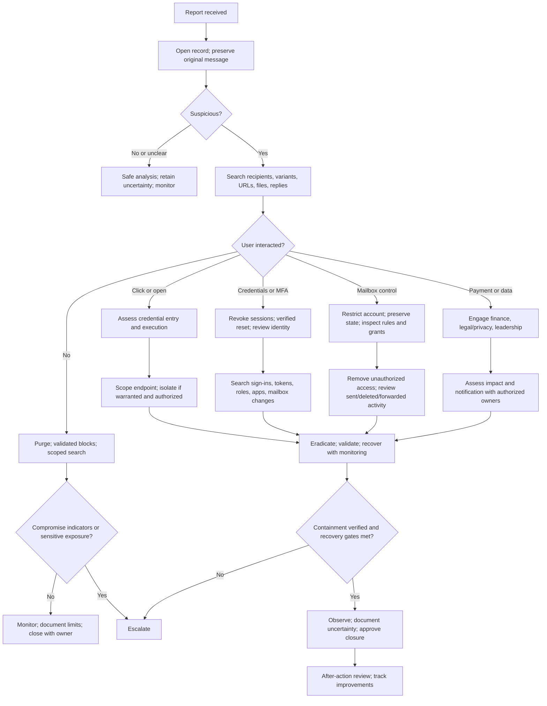

# Triage, Containment, and Recovery Decision Flows

| Gate | Proceed when | Stop/escalate when |
|---|---|---|
| Validate | Indicators/account preserved; approved tools used | Authority unclear, analysis unsafe, or evidence may be destroyed |
| Contain identity | User verified; scope and impact understood | Privileged identity, critical dependency, or uncertain blast radius |
| Isolate endpoint | Correct device and evidence needs considered | Safety, availability, or forensic conflict requires decision |
| Stop payment | Finance uses known-good workflow and authorized approver | Suspected loss: engage finance leadership/bank per policy |
| Recover | Access path removed, checks pass, owner accepts | Recurrence or material unknown remains |
| Close | Approvals, evidence, monitoring handoff, owners documented | High-impact unknown or unowned risk remains |
